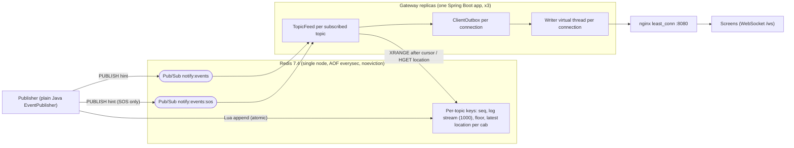
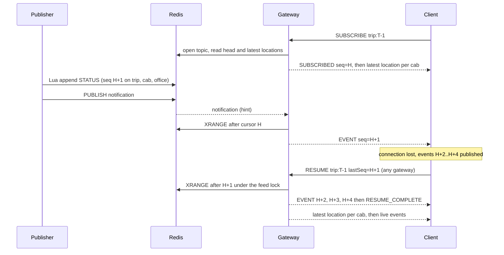

# Design Note — Live Trip Updates Fan-Out

A two-page summary of how the implementation works. Message formats: [PROTOCOL.md](PROTOCOL.md). Measurements:
[BENCHMARKS.md](BENCHMARKS.md). Setup and usage: [README](../README.md).

## Architecture

- **Redis is the single ordering authority.** `append-ordered.lua` assigns the next sequence number of every target
  topic (`INCR`), appends the event to that topic's stream (entry ID `{seq}-0`), trims the stream exactly to 1000
  entries and records the trimmed boundary (`floor`), in one atomic script. Locations use `append-location.lua`: they
  take a sequence number from the same counter but are stored only as the latest value per cab (`HSET`), never in the
  log. A topic's first sequence number is derived from Redis time (ms × 1000), so a topic recreated after expiry never
  reuses numbers. Keys are tenant-prefixed (`t:{tenant}:…`).
- **Pub/Sub carries hints, not data.** After a durable append the publisher sends a small notification (tenant, event
  id, type, topic sequence numbers). Every gateway subscribes; a gateway with no local subscriber for a topic ignores
  it. A gateway that has subscribers reads the events themselves from the stream after its cursor, so a lost, late or
  duplicated notification cannot lose or reorder anything. Every 5 s, and whenever a Pub/Sub subscription is
  (re)established, each feed catches up from the stream regardless of notifications.
- **SOS lane.** SOS events are appended through their own Redis connection and announced on their own channel
  (`notify:events:sos`), which each gateway reads on its own Pub/Sub connection, so an SOS does not queue behind
  location appends or location notifications. Ordering is unaffected: sequence numbers are assigned by the store, and a
  feed always delivers from its cursor in sequence order, whichever channel woke it.
- **Gateway internals.** One `TopicFeed` per locally subscribed (tenant, topic) reads Redis once for all local
  subscribers (drains run on virtual threads). Before each location read it checks for newly signalled reliable events
  and catches up first. Each connection has a `ClientOutbox` with a reliable lane (STATUS, DELAY, SOS and control
  frames, capacity 512) and a location lane conflated to the latest position per (topic, cab) (capacity 2048, evicts
  the oldest cab). One writer virtual thread per connection serves the reliable lane before locations.

## Event delivery and resume

Replay and live delivery are joined under the feed lock: the subscription starts after `lastSeq`, the replay is
queued, then `RESUME_COMPLETE`, then the latest locations, and only then does the subscription receive live events,
which it filters by sequence. A `lastSeq` older than the retained history (or unknown to Redis) gets
`RECOVERY_REQUIRED`; **no authoritative snapshot of trip status, delay or SOS state exists**, so the client can only
re-SUBSCRIBE (latest locations, then live events).

## Guarantees and their limits

| Property | Mechanism | Limit |
|---|---|---|
| Per-topic order of STATUS/DELAY/SOS | Atomic sequence per topic; feed delivers from its cursor; FIFO reliable lane | Order is per topic only; no order across topics or between locations and reliable events |
| At-least-once, client dedup | Durable append before notify; reconciliation; resume; clients drop `seq ≤ last` | Redis crash can lose up to ~1 s of acknowledged writes (AOF `everysec`) |
| Resume replays exactly the missed reliable events | Bounded log per topic (1000 entries, 24 h idle TTL) | Beyond it: `RECOVERY_REQUIRED`, no state snapshot |
| Locations: latest per cab | Latest-value hash; conflation in the outbox | Intermediate positions are dropped by design |
| Back-pressure | Bounded lanes; reliable overflow closes the connection (`4008`) instead of dropping | The slow client must reconnect and resume |
| SOS priority | Own Redis connection and channel; feed preemption; reliable lane first | Redis executes all commands on one thread; a client mid-reconnect waits for its reconnect |
| Tenant isolation | Tenant from the authenticated identity; tenant-prefixed keys; check on every SUBSCRIBE/RESUME and every 30 s | Dev token authenticator only (no production identity provider) |

## Memory, complexity and scaling

- **Per connection:** measured ≈ 130 KiB of gateway container memory per subscribed connection (upper bound, see
  [BENCHMARKS.md](BENCHMARKS.md)). Worst case adds a full outbox: 512 reliable + 2048 location references. When the
  reliable lane is full the connection is closed with `4008`; when the location lane is full the oldest cab's pending
  location is evicted.
- **Replay buffer:** 1000 reliable events per topic; exhausted ⇒ `RECOVERY_REQUIRED`. Redis at `maxmemory` (512 MB,
  `noeviction`) rejects appends; nothing is silently evicted.
- **Complexity:** a publish is one Lua call doing O(T) work for T target topics (≤ 4). A notification costs a gateway
  O(T) map lookups and never blocks. A feed drain is O(k × s) for k new events and s local subscribers of the topic;
  each offer to an outbox is O(1), including conflation.
- **Where it stops scaling (reasoned, not measured):** every gateway receives every notification, so notification
  volume per gateway grows with the total event rate, not with its own subscribers; all appends go to one Redis
  primary. Gateway memory grows linearly with connections (≈ 6,000 per 1 GB gateway at the measured rate, before
  headroom for failover). The case-study scale (200,000 screens, 20,000 cabs) was not tested.

## Failure modes

| What fails | What the user sees | How the system recovers |
|---|---|---|
| Gateway killed | Socket drops (1006) | Client reconnects to another gateway and RESUMEs; missed reliable events replayed (measured: 0 lost) |
| Gateway restored | Nothing for existing clients | Rejoins Pub/Sub on start; new connections may use it; existing clients are not moved back |
| Slow or frozen client | Its locations conflated; if its reliable lane fills, close `4008` | Client reconnects and resumes; other clients unaffected |
| Half-open or silent connection | — | Ping every 20 s; closed with `4010` after 60 s without traffic |
| Client away beyond retained history | `ERROR RECOVERY_REQUIRED` | Client re-SUBSCRIBEs: latest locations, then live; missed status/delay/SOS are not reconstructed |
| History trimmed during a replay or a lagging feed | Close `4009` | Client reconnects and resumes or re-subscribes |
| Notification lost, late or duplicated | Nothing (or delay up to 5 s) | Next notification or reconciliation reads the stream from the cursor; duplicates filtered by sequence |
| Notification publish fails after the append | Delay up to 5 s | Event is durable; reconciliation delivers it |
| Redis unreachable | `ERROR UNAVAILABLE` on SUBSCRIBE/RESUME; no live updates; gateway not ready | Feeds retry on reconciliation; Lettuce reconnects; clients resume |
| Redis out of memory | Publish rejected (`AppendRejectedException`) | `noeviction` keeps history intact; operator action |
| Permission withdrawn | `ERROR SUBSCRIPTION_REVOKED` | Revalidated every 30 s; pending events of that topic purged |
| Forbidden or unknown topic | `ERROR FORBIDDEN` (same answer for both) | Connection stays open; counted in metrics |

## Trade-offs

- **Ordering over global order:** order is guaranteed per topic only. A global order would serialise every tenant
  through one sequence and buys nothing a screen can use.
- **Consistency vs availability:** Redis is the only source of truth. While it is down, nothing is published or
  replayed (no stale local delivery), but connections stay open and clients resume afterwards. A single Redis node
  with AOF `everysec` trades up to ~1 s of acknowledged writes on a Redis crash for simplicity; Redis HA was left out.
- **At-least-once over exactly-once:** gateways may resend after reconnects; clients drop duplicates by sequence.
  This keeps gateways stateless across failures.
- **Latency vs cost:** notifications are broadcast to every gateway and filtered locally (simple, ~one Pub/Sub hop
  of latency) instead of routing per topic; this is the first scaling limit.
- **Memory bounds over completeness:** bounded outboxes disconnect a slow client rather than buffer without limit;
  a bounded replay log means long absences end in `RECOVERY_REQUIRED`, and without a state snapshot the client then
  lacks the trip's current status until the next event.
- **Locations are lossy by design:** only the latest position per cab matters, so locations are conflated and are not
  replayed individually.

## Deliberately left out

HTTP ingestion endpoint, production identity provider (JWT), authoritative state snapshots, Redis HA/Cluster,
notification sharding, caching layer, client-side redistribution back to a restored gateway, frontend.
